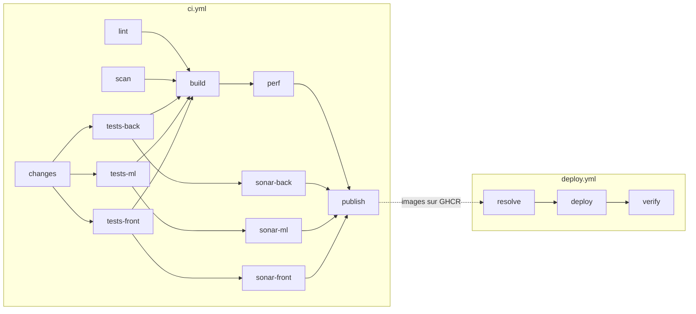

# Pipeline CI/CD

Ce document décrit toute la chaîne d'intégration et de déploiement continus du projet : ce
qui la déclenche, ce que fait chaque job, ce qui fait échouer une exécution, ce qu'il faut
configurer et comment réagir quand elle est rouge. Le README en donne le résumé (section
_Intégration continue_) ; ce document est la référence.

## Vue d'ensemble

La chaîne compte trois workflows GitHub Actions, dans `.github/workflows/`, et deux filets
locaux, les hooks Git, qui lancent les mêmes contrôles que la CI avant même un push.

| Workflow | Fichier | Déclencheurs | Rôle |
|---|---|---|---|
| CI | `ci.yml` | chaque pull request, chaque push sur `main`, à la demande | contrôler, tester, scanner, construire, puis publier les images |
| Deploy to Azure VM | `deploy.yml` | fin d'une CI réussie sur `main`, à la demande | déployer la dernière version validée sur la VM, puis vérifier le site depuis Internet |
| ML - Daily Predictions | `predict.yml` | à la demande seulement | calculer les prévisions sur la VM, avec l'image ML déployée |



Le principe : **une image n'est publiée qu'après avoir passé tous les contrôles de son
commit**, et le déploiement ne prend que des images publiées. Ce qui tourne sur la VM est
donc toujours une version validée.

## Le workflow CI (`ci.yml`)

### Déclencheurs, concurrence et droits

- **Déclencheurs** : toute pull request, tout push sur `main` (donc chaque merge), et le
  bouton _Run workflow_ de l'onglet _Actions_.
- **Concurrence** : un nouveau push sur une pull request annule l'exécution précédente de
  cette pull request. Les exécutions sur `main` ne sont jamais annulées : chacune publie les
  images de son propre commit, et une exécution annulée les perdrait.
- **Droits** : `contents: read` par défaut. Seuls `changes` (lecture des pull requests, pour
  lister les fichiers modifiés) et `publish` (`packages: write`, pour pousser sur GHCR)
  reçoivent davantage.

### Ce qui lance quoi : le job `changes`

`changes` liste les fichiers modifiés par la pull request ou par le push (`dorny/paths-filter`)
et décide des jobs à lancer. Les tests d'un composant sont _ignorés_ quand aucun de ses fichiers n'a changé ; un
job ignoré ne fait pas échouer la CI.

| Sortie | Fichiers surveillés | Jobs qu'elle déclenche |
|---|---|---|
| `back` | `app/back/**`, `db/**`, `pyproject.toml` | `tests-back`, `sonar-back` |
| `ml` | `ml/src/**`, `ml/tests/**`, `ml/scripts/**`, `ml/pyproject.toml`, `ml/Dockerfile`, `ml/Dockerfile.predict`, `ml/.dockerignore`, `pyproject.toml` | `tests-ml`, `sonar-ml` |
| `front` | `app/front/**` | `tests-front`, `sonar-front` |
| `shared` | `.github/workflows/ci.yml`, `sonar-project.properties` | **tous** les tests et les analyses Sonar |
| `perf` | le code du back, de la base, du ML et du front, les Dockerfiles du ML, `docker-compose*.yml`, `tests/perf/**`, `ci.yml` | `build`, `perf` |
| `deploy` | le code du back, de la base, du ML et du front, les Dockerfiles du ML, `docker-compose.yml`, `docker-compose.deploy.yml` | `publish` |

`changes` vérifie aussi la configuration SonarQube : pour chaque composant, l'analyse ne
tourne que si le secret `SONAR_TOKEN` et les variables `SONAR_ORGANIZATION` et
`SONAR_PROJECT_KEY_<COMPOSANT>` existent. Sinon, une note l'indique dans le résumé du run et
le job Sonar est ignoré.

Un lancement manuel exécute tous les jobs, sauf `publish`, réservé aux pushs sur `main`.

À l'inverse, **un changement qui ne touche que `deploy.yml`, `deploy/` (le `Caddyfile`, le
contrôle du site), `predict.yml`, la documentation ou les notebooks ne publie aucune
image** : la CI se limite à `lint` et `scan`, et le déploiement qui suit n'a rien de nouveau
à déployer.

### Les jobs

| Job | Quand | Ce qu'il fait | Il échoue si |
|---|---|---|---|
| `lint` | toujours | `sh scripts/check.sh` : ruff (lint et formatage), espaces et lignes vides en fin de fichier ; le même script que les hooks locaux | un contrôle échoue |
| `scan` | toujours | Trivy sur le dépôt : dépendances vulnérables, mauvaises configurations (Terraform, Dockerfiles, compose), secrets commités | un constat HIGH ou CRITICAL |
| `tests-back` | `back`, `shared` ou manuel | `pytest` avec couverture, contre un vrai PostgreSQL 16 lancé en service ; `REQUIRE_DB=1` fait échouer, au lieu d'ignorer, les tests qui ont besoin de la base | un test échoue, ou la couverture passe sous 80 % (`app/back/pyproject.toml`) |
| `tests-ml` | `ml`, `shared` ou manuel | `pytest` avec couverture | un test échoue, ou la couverture passe sous 80 % (`ml/pyproject.toml`) |
| `tests-front` | `front`, `shared` ou manuel | Node (version de `app/front/.nvmrc`) avec `TZ=Europe/Paris`, `npm ci`, contrôle des types et build de production, tests Vitest avec couverture | un test, le typage ou le build échoue, ou un seuil de couverture n'est pas atteint (de 75 à 90 % selon le dossier, `app/front/vitest.config.ts`) |
| `sonar-back`, `sonar-ml`, `sonar-front` | Sonar configuré, composant modifié, tests du composant réussis | analyse SonarQube Cloud avec le rapport de couverture des tests, dont les chemins sont remis relatifs à la racine du dépôt | le _quality gate_ est rouge |
| `build` | `perf` ou manuel ; `lint` et `scan` verts ; chaque suite de tests verte ou ignorée | construit les cinq images (`back`, `ml`, `mlflow`, `front`, `ml-predict`) avec le cache GitHub, les scanne avec Trivy et les passe aux jobs suivants en artefacts | un build échoue, ou une image a une faille HIGH ou CRITICAL **qui a un correctif** |
| `perf` | `build` vert | démarre la stack avec ces images (`docker-compose.yml` + `docker-compose.ci.yml`) et une doublure de l'API EnerVision, attend la base et les premières données, puis lance k6 : 10 utilisateurs pendant 30 secondes (`tests/perf/load.js`) | le 95e centile dépasse 500 ms, globalement ou sur `/api/consommations`, ou plus de 1 % des requêtes échouent |
| `publish` | push sur `main`, changement `deploy`, `perf` vert, analyses Sonar vertes ou ignorées | pousse les cinq images sur GHCR, étiquetées par le SHA du commit, sans `latest` | la publication échoue |

**Ajouter un job qui dépend de `build`, `perf` ou `publish`** : écrire sa condition avec
`!cancelled()` et le résultat du job requis (`needs.build.result == 'success'`). Sinon,
GitHub l'ignore dès qu'un job en amont a été ignoré, même si la chaîne a tourné
entre-temps.

### Ce que l'on retrouve après une exécution

- **Résumé du run** : la couverture de chaque suite de tests.
- **Artefacts** (onglet _Actions_, puis le run, puis _Artifacts_), gardés 14 jours :
  `back-coverage` et `ml-coverage` (HTML et XML), `front-coverage` (HTML), `k6-results`
  (résumé JSON du test de charge). Les images exportées ne sont gardées qu'un jour.
- **Images publiées** : `ghcr.io/eadl-projet-piscine/smart_energy_optimizer/<service>:<sha>`,
  pour `back`, `ml`, `mlflow`, `front` et `ml-predict`.

## Le workflow de déploiement (`deploy.yml`)

Il se lance à la fin de chaque CI **réussie** déclenchée par un push sur `main`, ou à la
main depuis `main`. Deux déploiements ne tournent jamais en même temps (groupe
`production-deploy`), et un déploiement en cours n'est jamais annulé.

| Job | Où | Ce qu'il fait |
|---|---|---|
| `resolve` | runner auto-hébergé, sur la VM | cherche, parmi les 50 derniers commits de `main`, le plus récent dont les cinq images existent sur GHCR : c'est la dernière version validée. Une CI rejouée ou des CI terminées dans le désordre ne remettent donc jamais une ancienne version en production. Si cette version tourne déjà, il n'y a rien à déployer, sauf pour un lancement manuel |
| `deploy` | runner auto-hébergé, environnement GitHub `production` | récupère le commit, se connecte à GHCR, vérifie la configuration (`docker compose config`), tire les images et relance la stack (`docker compose -f docker-compose.yml -f docker-compose.deploy.yml --env-file ~/enervision/.env up -d --no-build --remove-orphans`) ; lit le domaine du site (`SITE_DOMAIN`) pour le job suivant |
| `verify` | runner GitHub, donc depuis Internet | lance `deploy/smoke_test.sh` : HTTPS avec un certificat valide (attente jusqu'à 5 minutes au premier démarrage de Caddy), redirection du HTTP, en-têtes de sécurité du `Caddyfile`, réponse 401 de l'API sans session, ports 22, 5000, 5432 et 8000 fermés ; écrit un tableau dans le résumé du run et échoue au moindre écart |

**En production**, seul le conteneur `proxy` (Caddy, `deploy/Caddyfile`) est joignable depuis
Internet, sur les ports 80 et 443 ; il obtient seul le certificat Let's Encrypt du nom DNS de
la VM. La configuration vit sur la VM, jamais dans le dépôt : `~/enervision/.env`
(`SITE_DOMAIN`…), `~/enervision/back.env` (`AUTH_ENABLED`, `JWT_SECRET`…) et
`~/enervision/ml.env`. La mise en service, à faire une fois, est décrite dans le README
(section _Déploiement_).

**Redéployer à la main** : onglet _Actions_, _Deploy to Azure VM_, _Run workflow_ sur `main`.
Un lancement manuel redéploie même une version qui tourne déjà, par exemple pour appliquer
une modification d'un fichier `.env` de la VM.

**Vérifier le site à la main** : `deploy/smoke_test.sh <le nom DNS de la VM>`, depuis
n'importe quel poste.

## Le workflow de prédiction (`predict.yml`)

Lancé à la main seulement : la planification quotidienne (`0 1 * * *`) est écrite mais
commentée. Sur la VM, il retrouve la version de l'image ML déployée et lance
`docker compose run --rm --no-build ml-predict --source api`, avec le même `.env` que le
déploiement.

## Contrôles locaux : les hooks Git

Les hooks bloquent un commit ou un push qui ferait échouer le job `lint`. À activer une fois
après le clone :

```bash
git config core.hooksPath .githooks
```

| Hook | Ce qu'il contrôle |
|---|---|
| `pre-commit` | les fichiers indexés : `scripts/check.sh --staged` |
| `pre-push` | chaque commit poussé : `scripts/check.sh <commit>` |

Aucun Python n'est nécessaire : au premier lancement, `scripts/check.sh` télécharge ruff en
binaire autonome, à la version épinglée dans `pyproject.toml`, vérifie son empreinte SHA-256
et le range dans `.tools/` (ignoré par Git). Le détail est dans le README (section
_Vérifications locales_).

**Rejouer la CI sur son poste** : `sh scripts/check.sh` pour `lint` ; les commandes de la
section _Tests_ du README pour les tests et le test de charge.

## Secrets, variables et environnements

| Nom | Type | Utilisé par | Rôle |
|---|---|---|---|
| `GITHUB_TOKEN` | fourni par GitHub | CI (Trivy, `publish`), déploiement (GHCR) | télécharger la base de Trivy, publier et tirer les images |
| `SONAR_TOKEN` | secret du dépôt | `changes`, `sonar-*` | s'authentifier auprès de SonarQube Cloud |
| `SONAR_ORGANIZATION` | variable du dépôt | `changes`, `sonar-*` | organisation SonarQube Cloud |
| `SONAR_PROJECT_KEY_BACK`, `_ML`, `_FRONT` | variables du dépôt | `changes`, `sonar-*` | un projet SonarQube par composant |
| `production` | environnement GitHub | `deploy` | limite le déploiement aux branches protégées |
| `~/enervision/.env`, `back.env`, `ml.env` | fichiers sur la VM | `deploy`, `predict` | configuration et secrets de production |

## Quand la CI est rouge

| Symptôme | Cause habituelle | Que faire |
|---|---|---|
| `lint` rouge | formatage ou règle ruff | `sh scripts/check.sh`, corriger, recommiter ; activer les hooks pour l'éviter |
| `scan` rouge | dépendance vulnérable, mauvaise configuration ou secret | mettre à jour la dépendance ou corriger la configuration ; une exception doit être justifiée dans le code, comme les règles 80 et 443 de `infra/main.tf` (`trivy:ignore`) |
| `tests-front` vert en local, rouge en CI | fuseau horaire ou dépendance locale | la CI tourne en `TZ=Europe/Paris` après un `npm ci` : rejouer avec le même fuseau et `npm ci` |
| `tests-back` rouge sur un test de base de données | la base manque ou le schéma diverge | en CI, ces tests ne sont jamais ignorés (`REQUIRE_DB=1`) ; tester sur une base neuve (`docker compose down -v && docker compose up -d --build`) |
| couverture à 0 % dans SonarQube | chemins du rapport de couverture | le job Sonar remet les chemins relatifs à la racine du dépôt ; vérifier que le rapport vient bien des tests du même composant |
| un job qui dépend de `build` ne tourne pas | condition par défaut de GitHub | ajouter `!cancelled()` et le résultat du job requis (voir plus haut) |
| la CI de `main` est verte, mais rien n'est publié | aucun changement déployable | normal : seul un changement `deploy` publie des images |
| le déploiement est vert, mais `deploy` et `verify` sont ignorés | la dernière version validée tourne déjà | normal ; lancer le workflow à la main pour forcer un redéploiement et le contrôle du site |
| `verify` rouge | le message dit quel contrôle | « 200 without a session » : authentification désactivée ; 502 à 504 : back injoignable ; statut 000 : site injoignable ou certificat refusé |

## Limites connues

- Le contrôle du site (`verify`) ne tourne qu'après un déploiement : une panne entre deux
  déploiements n'est pas détectée, faute de contrôle planifié.
- La prédiction se lance à la main, et ses résultats ne sont pas encore écrits dans la table
  que lit l'API.
- Ni scan dynamique (OWASP ZAP), ni préproduction, ni approbation humaine avant la production.
- La règle de protection de `main` exige une pull request et une relecture, mais pas une CI
  verte.
- `ci.yml` désigne ses actions par une étiquette de version (`actions/checkout@v5`), quand
  `deploy.yml` et `predict.yml` les épinglent par SHA.
- Le runner auto-hébergé tourne sur la VM de production, alors que le dépôt est public : voir
  le rapport de sécurisation (EC04).
