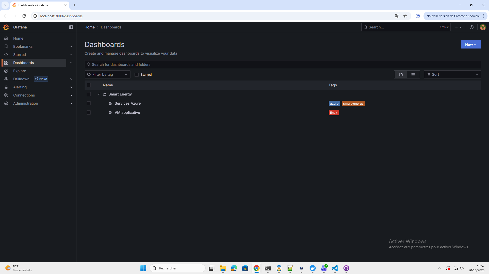
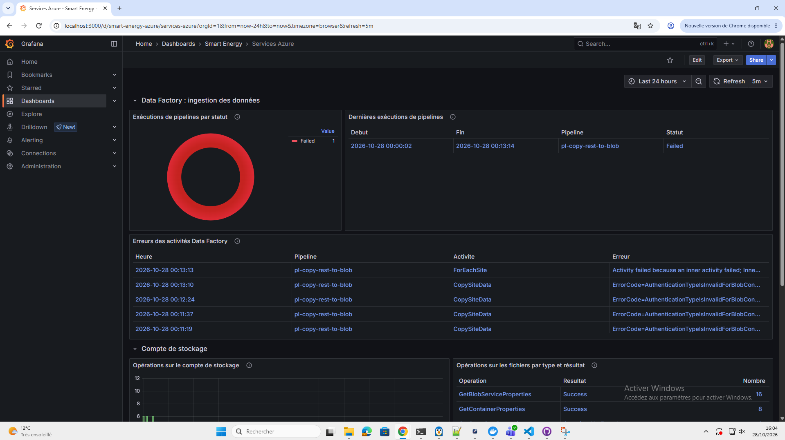
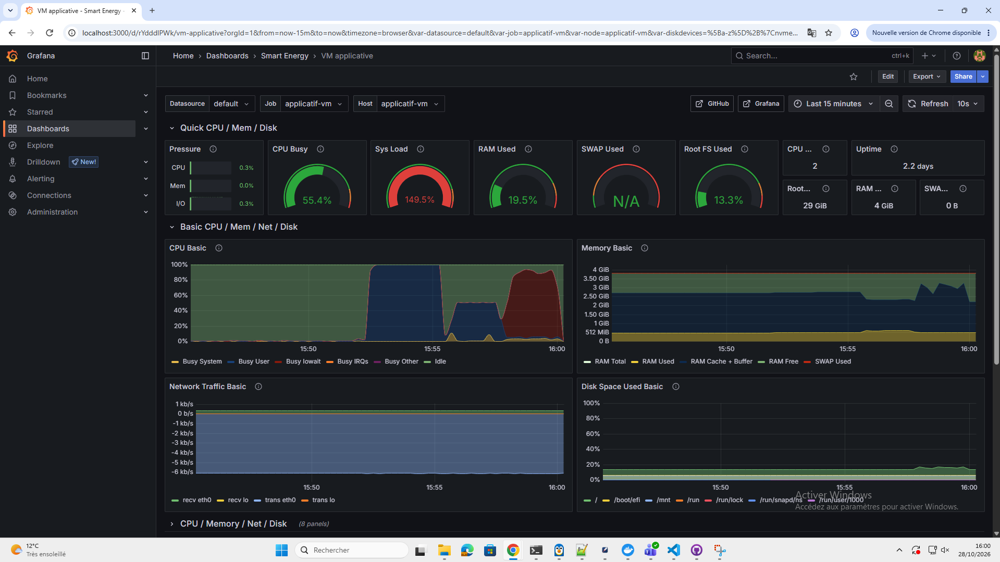
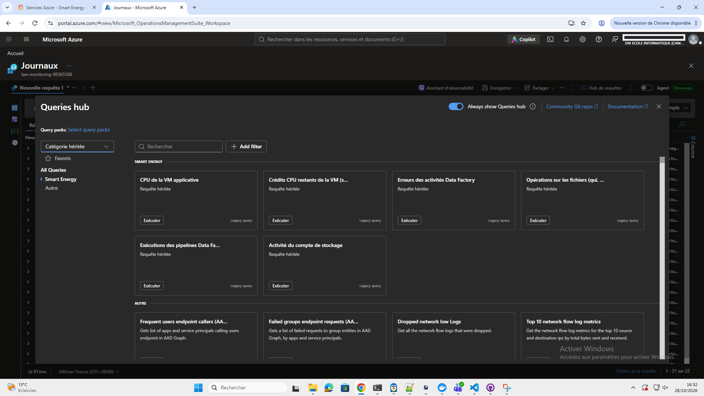

# Rapport de sécurisation

## 1. Objet et périmètre

Ce rapport fait l'état de la sécurité de la plateforme EnerVision telle qu'elle est déployée, en s'appuyant sur des **preuves produites par l'équipe le 27/10/2026, refaites le 28/10** : scans, tests d'accès et rendus de configuration.

**Périmètre audité :**

- **Le code et l'infrastructure :** branche `main` du dépôt `EADL-projet-piscine/smart_energy_optimizer`, commit `a6a09c6` (27/10, 11 h 46). Les constats ont été revérifiés sur `46c8ead` (27/10, 15 h 16) : Trivy et zizmor donnent les mêmes résultats, et les PR fusionnées depuis (tests du front, nouveau workflow de déploiement #76, supervision Azure #81, documentation de l'API #85) ne lèvent aucun des constats ci-dessous.
**Mise à jour du 28/10 :** l'audit a été refait sur `993f82b` (28/10, 15 h 33), après l'authentification (PR #86, #87, #93), le HTTPS (PR #94), Prometheus et Grafana (PR #95), le contrôle du site après chaque déploiement (PR #98, #100), les recommandations (PR #101) et les workflows de prédiction et d'entraînement.
**Mise à jour du 30/10 :** les mots de passe de la base de données (PR #117) et les secrets GitHub Actions ont été remplacés ; la section 9 intègre la vérification de la supervision. Les PR fusionnées le 30/10 (#119, #122, #124, #125) ne sont pas couvertes par les scans : la PR #122, qui modifie la déclaration des ressources réseau dans Terraform, impose de relancer `trivy config` et `terraform validate`.
- **L'infrastructure Azure décrite en Terraform** (`infra/`) : VM, réseau, groupe de sécurité réseau (NSG), compte de stockage, Data Factory.
- **La chaîne CI/CD GitHub Actions** (`ci.yml`, `deploy.yml`, `predict.yml`, `train.yml`) et les réglages du dépôt GitHub.
- **La base PostgreSQL** (rôles et droits), **l'API métier**, **les images Docker** et, depuis le 28/10, **le site de production**, interrogé depuis Internet.

**Hors périmètre :** l'état réel des ressources Azure n'a pas été interrogé, faute d'accès à l'abonnement au moment de l'audit, à l'exception de la supervision, vérifiée sur l'abonnement le 28/10 (section 9).

*Tableau 1 — Méthode et outils*

| Ce qui est vérifié | Outil et version | Résultat |
|-------------------------------------|-------------------------|----------------------------|
| Mauvaises configurations : Terraform, Dockerfiles | Trivy 0.58.1, `trivy config` (commit `993f82b`, 28/10) | Terraform 47/47 ; 6 alertes faibles (une par Dockerfile) |
| Secrets et dépendances vulnérables dans l'arborescence | Trivy 0.58.1, `trivy fs` | 0 constat |
| Secrets dans tout l'historique Git (211 commits, toutes branches, scan du 27/10) | gitleaks 8.24.3 | 1 faux positif |
| Sécurité des quatre workflows GitHub Actions | zizmor 1.5.2 | 2 élevés, 11 moyens (inchangé) |
| Droits réels des rôles PostgreSQL | PostgreSQL 16.15 jetable + 14 tests | 14/14 conformes |
| Configuration réellement appliquée en production | `docker compose config` (Compose 5.6.1) | seuls 80 et 443 publiés |
| Vulnérabilités des images publiées | Trivy dans la CI (exécution 40679512865, 6 images) | 0 HIGH/CRITICAL corrigeable |
| Visibilité, protection de `main`, secrets, runner | API GitHub (lecture seule) | dépôt public + runner auto-hébergé |
| Authentification et exposition du site | site de production interrogé depuis Internet : job `verify`, `curl`, `openssl` | 401 sans session ; TLS 1.3 ; seuls 80 et 443 ouverts |
| Supervision appliquée sur l'abonnement | Grafana, portail Azure (captures du 28/10) | Grafana et Log Analytics opérationnels ; aucune alerte |

## 2. Synthèse des constats

Échelle : **Élevée** (exploitable, impact fort), **Moyenne** (à corriger avant un client pilote), **Faible** (amélioration), **Info**.

*Tableau 2 — Constats et statut au 30/10*

| Constat | Sévérité | Statut au 30/10 | Source |
|----------------------------------------------------|------------|------------------------|-----------|
| L'API métier répondait sans authentification ; seule la règle réseau la protégeait | Élevée | **Corrigé le 28/10** : 401 sans session en production | test du site |
| Dépôt **public** avec un runner auto-hébergé sur la VM de production, utilisé par trois workflows | Élevée | Ouvert | réglages GitHub |
| En production, l'API et le ML se connectaient avec les **mots de passe de développement** des rôles PostgreSQL | Moyenne (Élevée le 27/10) | **Corrigé** : mots de passe réécrits | rendu Compose |
| Secrets dormants dans GitHub, dont une clé SSH privée de la VM, utilisés par aucun workflow | Moyenne | **Corrigé** : secrets réécrits | réglages GitHub |
| State Terraform local, sans verrou ; mot de passe de l'API source en clair dans le state ; `api_password` et `api_username` non marquées `sensitive` | Moyenne | Ouvert | code |
| Base, API, ML et front publiés sur toutes les interfaces de la VM ; pas de TLS | Moyenne | **Corrigé le 28/10** : seul Caddy est publié (80, 443), TLS 1.3 | rendu Compose, test du site |
| Workflows : jeton GitHub conservé par `checkout` (11 cas), déclencheur `workflow_run`, cache partagé, actions non épinglées | Moyenne | Ouvert | audit zizmor |
| La protection de `main` n'exige pas une CI verte avant fusion | Moyenne | Ouvert | réglages GitHub |
| Supervision (Azure Monitor, Prometheus, Grafana) : appliquée et vérifiée ; aucune alerte | Moyenne | Partiel : en place, alertes manquantes | captures, section 9 |
| Le pipeline Data Factory échoue à écrire dans le stockage (`AuthenticationTypeIsInvalidForBlobConnection`) : les données brutes ne sont pas collectées | Moyenne | Ouvert | supervision, section 9 |
| Pas d'instruction `HEALTHCHECK` dans les 6 Dockerfiles ; images de base non épinglées à une version | Faible | Ouvert | scan Trivy, code |
| Un signalement de gitleaks, analysé : faux positif | Info | Analysé | scan gitleaks |

*Tableau 3 — Ce qui est vérifié conforme*

| Mesure | Source |
|--------------------------------------------------------------------------------|--------------------|
| Terraform : 47 contrôles de sécurité passés, aucun échec, au 28/10 ; les ouvertures 80 et 443 portent une exception justifiée (`trivy:ignore`) | scan Trivy des configurations |
| Images publiées : aucune vulnérabilité HIGH ou CRITICAL corrigeable (back, ML, MLflow, front, prédiction, entraînement) | scans d'images de la CI |
| Aucun secret ni dépendance vulnérable HIGH/CRITICAL dans l'arborescence | scan Trivy de l'arborescence |
| Moindre privilège dans la base : 14 tests sur 14 conformes | test des rôles PostgreSQL |
| Conteneurs exécutés sans droits root (`uid=999(appuser)`) | test du 27/10 |
| NSG : 22 depuis une seule adresse IP, 80 et 443 pour le site ; depuis Internet, 22, 5000, 5432 et 8000 sont fermés | code, test du site |
| Site en HTTPS (certificat Let's Encrypt, TLS 1.3), HTTP redirigé, en-têtes HSTS, `nosniff` et `X-Frame-Options: DENY` | test du site |
| API : 401 sans session sur toutes les routes testées ; documentation Swagger et `/health` du back non exposés | test du site |
| Contrôle automatique après chaque déploiement : HTTPS, en-têtes, 401 sans session, ports fermés | test du site, `deploy.yml` |
| Stockage : accès refusé par défaut, conteneur privé | code |
| CI : jeton GitHub en lecture seule par défaut ; écriture des paquets réservée au job `publish` | réglages GitHub, code |
| `main` protégée : pull request obligatoire avec une approbation, ni suppression ni force-push, aucun contournement | réglages GitHub |
| Supervision : Grafana et Prometheus joignables uniquement par tunnel SSH ; lecture d'Azure en lecture seule par identité managée | code, captures |

## 3. Surface d'exposition et règles réseau

Les numéros de ligne cités renvoient au commit audité `993f82b`.

**Ce que décrit le Terraform :**

- **NSG de la VM** (`infra/main.tf:126-166`) : trois règles entrantes. TCP 22 depuis `var.ip`, l'adresse du poste d'administration ; TCP 443 et 80 depuis Internet, pour le site (PR #94), chacune avec une exception Trivy justifiée. Les autres flux entrants tombent sur la règle Azure par défaut `DenyAllInBound`. L'accès SSH se fait par clé (`admin_ssh_key`, `main.tf:98`), sans mot de passe.
- **Compte de stockage** (`main.tf:39-42`) : `default_action = "Deny"` ; seuls l'adresse d'administration et le sous-réseau de la VM sont admis, plus les services Azure de confiance (`bypass`). Le conteneur `landing` est privé (`main.tf:32`).
- **Data Factory** (`infra/data_factory.tf:6`) : `public_network_enabled = false`.

**Ce que montre le rendu de la configuration de production (28/10) :** un seul service est publié vers l'extérieur, le proxy Caddy, sur 80 et 443. MLflow reste limité à `127.0.0.1:5000`. La base, l'API, le ML et le front ne publient plus aucun port : ils ne se parlent que par le réseau Docker.

**Ce que montre l'accès depuis Internet (28/10) :** le site répond en HTTPS avec un certificat Let's Encrypt valide (TLS 1.3) ; le HTTP redirige vers le HTTPS (308) ; les ports 22, 5000, 5432 et 8000 sont fermés ou filtrés. Ces points sont vérifiés automatiquement après chaque déploiement par le job `verify` (section 8).

## 4. Identités et accès

#### 4.1 Azure : identités managées et rôles

La VM, le compte de stockage et la Data Factory ont une **identité managée** (`main.tf:19`, `main.tf:94`, `data_factory.tf:8`). Data Factory est configurée pour écrire dans le stockage **sans clé ni mot de passe** : son service lié Blob déclare une authentification par identité managée (`data_factory.tf:70`). La supervision montre toutefois que cette écriture échoue (section 9) : le type d'authentification déclaré dans le service lié est à corriger.

L'identité de la VM a le rôle `Monitoring Reader`, en lecture seule, sur le groupe de ressources : Grafana s'en sert pour lire les métriques et les journaux Azure (section 9).

#### 4.2 GitHub : dépôt, branche principale, runner

- **Le dépôt est public depuis le 27/10 au matin.** Jusqu'au 26/10, il était privé, dans une organisation sur l'offre gratuite de GitHub : l'API refusait alors toute protection de branche. Le passage en public a rendu la règle de `main` applicable, mais il expose le code, la configuration et le runner. Le dossier de conception supposait un dépôt privé, condition que la documentation GitHub recommande pour les runners auto-hébergés.
- **Un runner auto-hébergé, `applicatif-vm`, est en ligne** et sert au déploiement ; depuis le 28/10, il exécute aussi les workflows de prédiction et d'entraînement, lancés à la main. Sur un dépôt public, une pull request venue d'un fork peut ajouter un workflow ciblant `self-hosted` ; seule protection : l'approbation demandée aux contributeurs **qui en sont à leur première contribution** (`approval_policy: first_time_contributors`). Un code arbitraire pourrait alors s'exécuter sur la VM de production, qui détient le fichier `.env` de production et l'accès à la base. Depuis la PR #76, le déploiement passe par l'environnement GitHub `production`, limité aux branches protégées mais sans approbation humaine : cela ne protège pas d'un workflow ajouté par une pull request.
- **`main` est protégée** par la règle « Protection main », créée le 19/10 mais appliquée seulement depuis le passage en public (27/10, 11 h 16), sans contournement : pull request obligatoire avec une approbation, suppression et force-push interdits. Elle **n'exige pas de CI verte**.
- **Jeton GitHub des workflows :** en lecture seule par défaut (`default_workflow_permissions: read`) ; `ci.yml` déclare `contents: read` et n'accorde `packages: write` qu'au job `publish` (`ci.yml:639-640`) ; `deploy.yml` est en lecture seule (`deploy.yml:10-11`).

#### 4.3 Base PostgreSQL : moindre privilège vérifié

Nous avons démarré une PostgreSQL 16 jetable, initialisée avec les scripts du dépôt (`db/init`, `db/migrations`), puis tenté 14 actions avec chaque rôle. **Les 14 résultats sont conformes à l'attendu.** Le rôle de l'application et le rôle ML ne sont ni super-utilisateurs, ni autorisés à créer des rôles ou des bases.

*Tableau 4 — Extrait du test des droits*

| Rôle | Action tentée | Résultat |
|----------------------|------------------------------------|------------------------------------------|
| `enervision_ml` | lire les comptes (`users`) | refusé : *permission denied for table users* |
| `enervision_ml` | supprimer des sites ; supprimer la table | refusé |
| `enervision_ml` | créer une table | refusé : *permission denied for schema public* |
| `enervision_ml` | lire les sites ; écrire par `upsert_site()` | autorisé |
| `enervision_app` | modifier ou supprimer la table `users` | refusé : *must be owner of table users* |
| `enervision_app` | enregistrer un mot de passe en clair | refusé par la contrainte `users_password_is_hash` |
| `enervision_app` / `enervision_ml` | lire une table créée plus tard | autorisé / refusé (droits par défaut) |

Le schéma garantit aussi qu'une table ajoutée plus tard n'est jamais ouverte au rôle ML sans une décision explicite dans `db/init/03_grants.sql`.

## 5. Authentification applicative

**Constat du 27/10.** Nous avions construit l'image de l'API depuis `main`, puis nous l'avions interrogée sans jeton : les routes métier ne répondaient **jamais 401**, et la spécification OpenAPI ne déclarait aucun schéma de sécurité. L'API n'avait aucune authentification.

**Corrigé le 28/10.** L'authentification est en place et active en production (PR #86, #87, #93, activée avec le HTTPS de la PR #94) :

- connexion par identifiant et mot de passe, condensé argon2 ; une contrainte de la base refuse toujours un mot de passe en clair (section 4.3) ;
- jeton JWT de 15 minutes, dans un cookie `HttpOnly`, `Secure` et `SameSite=Strict` ; le cookie `Secure` exige le HTTPS ;
- trois rôles (`admin`, `operator`, `viewer`) et un **contrôle d'accès par site** : un utilisateur ne voit que les sites de son compte, sinon 403 ; c'est la première faille du classement OWASP API Security Top 10 (accès aux objets d'un autre utilisateur) ;
- gestion des comptes réservée aux administrateurs, et écran de connexion dans le dashboard.

**Preuves.** En production, sans session, `/api/consommations`, `/api/previsions`, `/api/auth/me` et `/api/comptes` répondent **401**. Les tests de la CI couvrent le refus : 401 sans session, 403 pour un site hors du compte (`app/back/tests/auth/test_login.py:87`), 403 pour un lecteur (`test_access.py:171`) et sur la gestion des comptes. Après chaque déploiement, le job `verify` vérifie de nouveau le 401 depuis Internet.

**Point de vigilance.** L'authentification dépend de deux réglages de la VM, hors du dépôt : `AUTH_ENABLED=true` et un `JWT_SECRET` propre à la production, dans `back.env`. Le job `verify` fait échouer le déploiement si l'API répond 200 sans session : une désactivation accidentelle ne passerait pas inaperçue.

## 6. Gestion des secrets

*Tableau 5 — Cycle de vie des secrets*

| Lieu | Mécanisme | État |
|----------------|--------------------------------------------------|----------------------------------|
| Poste de développement | `.env` ignoré par Git ; `.env.example` versionné sans valeurs | conforme : aucun secret trouvé (scans Trivy et gitleaks) |
| Code | identifiants de base par défaut retirés du code (commit `f4ad23e`) ; mot de passe de l'API source typé `SecretStr` | conforme |
| CI | jeton GitHub temporaire et limité ; `SONAR_TOKEN` en secret ; secrets du dépôt réécrits | conforme |
| Production (VM) | fichiers `.env` et `back.env` sur la VM, droits restreints (`chmod 600`), chargés au déploiement (`SITE_DOMAIN`, `AUTH_ENABLED`, `JWT_SECRET`, mots de passe de la base) | conforme : mots de passe de la base réécrits |
| Azure | identité managée entre Data Factory et le stockage ; mot de passe de l'API source dans le service lié, type `SecureString` | conforme dans la configuration ; écriture vers le stockage en échec (section 9) |
| Terraform | `*.tfvars` et `*.tfstate` exclus de Git ; state local, sans verrou ; `api_password` et `api_username` non marquées `sensitive` (`grafana_admin_password` l'est) | **écart** |

**Mots de passe de développement en production — corrigé.** Le 28/10, le rendu de la configuration de production montrait que l'API et le ML se connectaient avec les mots de passe de développement écrits en dur dans `docker-compose.yml` (`APP_DB_PASSWORD`, `ML_DB_PASSWORD` et les `DATABASE_URL` correspondantes), `docker-compose.deploy.yml` ne surchargeant que `POSTGRES_PASSWORD`. Dans Docker Compose, `environment` l'emporte sur `env_file` : un `back.env` de production ne suffisait donc pas à les remplacer. Ces mots de passe étaient publics, puisque le dépôt l'est, mais utilisables uniquement depuis le réseau Docker de la VM, la base n'étant plus publiée. **Depuis, les mots de passe de la base ont été réécrits** : ils sont désormais obligatoires en variables dans `docker-compose.yml` (`APP_DB_PASSWORD`, `ML_DB_PASSWORD`), sans valeur par défaut, et renseignés dans le `.env` de la VM (PR #117, 29/10).

**Secrets dormants dans GitHub — corrigé.** Le dépôt stockait `VM_SSH_PRIVATE_KEY`, `VM_HOST`, `VM_USER`, `VM_HOST_FINGERPRINT`, `AZURE_SUBSCRIPTION_ID` et `AZURE_TENANT_ID`, utilisés par aucun workflow : un secret inutilisé n'apporte que du risque. **Depuis, les secrets GitHub Actions ont été réécrits.**

**State Terraform.** Le state, local, contient en clair le mot de passe de l’API source. Marquer `api_password` et `api_username` comme `sensitive`, comme `grafana_admin_password`, les masque à l’affichage, mais ils restent en clair dans le state. Le vrai correctif est un backend `azurerm` : state stocké dans un compte de stockage chiffré, à accès contrôlé, avec verrou.

**Signalement de gitleaks, faux positif.** gitleaks signale un `curl --user` dans `ci.yml` (commit `25d5253`, une étape temporaire annulée par `3d95aeb`). Analyse de la forme de l'argument, sans en afficher la valeur : c'est une **référence de variable** (`$SONAR_TOKEN:`), pas un secret écrit en clair. Nous le marquerons comme accepté dans un fichier `.gitleaksignore`, avec sa justification.

## 7. Infrastructure as code et conteneurs

**Terraform.** Au commit audité (`993f82b`, 28/10), Trivy passe 47 contrôles de sécurité sur `infra/` sans aucun échec. Les ouvertures 80 et 443 du NSG portent une exception explicite (`trivy:ignore:AVD-AZU-0047`), justifiée en commentaire : c'est l'exposition voulue du site. Ces contrôles ne voient pas les valeurs des variables, comme l'adresse admise dans le NSG.

**Dockerfiles.** 27 contrôles sur 28 réussis pour chacun des 6 Dockerfiles (back, front, ML, MLflow, prédiction, entraînement). Seule alerte, de faible sévérité : pas d'instruction `HEALTHCHECK`. Les bonnes pratiques sont vérifiées :

- images de base minimales (`python:3.12-slim`, `nginx-unprivileged` en alpine) ;
- utilisateur dédié non-root (`USER appuser`, confirmé à l'exécution : `uid=999`) ;
- construction en deux étapes pour le front ;
- aucun secret dans les images.

**Images publiées (28/10).** À chaque pull request, la CI scanne les 6 images et **échoue** sur toute vulnérabilité HIGH ou CRITICAL qui a un correctif. Dernière exécution complète sur `main` (28/10, 12 h 22, exécution 40679512865) : les 6 constructions et leurs scans sont verts, donc **aucune vulnérabilité bloquante**. Les images sont étiquetées par le SHA du commit, et c'est cette étiquette qui est déployée.

**Limites.** Une image saine aujourd'hui peut ne plus l'être quand une faille est publiée : il manque un rescan planifié des images déjà déployées. Et les images de base ne sont pas épinglées à une version précise (`nginx/nginx-unprivileged:alpine`, `node:22-alpine`, `python:3.12-slim`) : une reconstruction peut changer d'image de base sans revue. Le proxy, lui, l'est (`caddy:2.11.6-alpine`), comme les images de la supervision (section 9). Correctif : épingler par version complète, ou par empreinte (*digest*).

## 8. Sécurité de la chaîne CI/CD

**Contrôles intégrés au pipeline :** Trivy sur le dépôt (dépendances, configurations, secrets) et sur chaque image ; SonarQube avec *quality gate* (back et front verts lors de la dernière exécution) ; tests avec seuil de couverture ; test de charge ; publication seulement si tout est vert.

**Audit des quatre workflows par zizmor (refait le 28/10 : résultat identique) :**

- **11 constats moyens, `artipacked`** : `actions/checkout` conserve le jeton GitHub dans le dossier cloné (`ci.yml`, 11 jobs). Correctif : `persist-credentials: false`, déjà présent dans `deploy.yml:50`, `deploy.yml:171` et `deploy.yml:260`.
- **1 constat élevé, `dangerous-triggers`** : `deploy.yml` est déclenché par `workflow_run`. Le risque est circonscrit : le job exige une CI réussie, sur `main`, déclenchée par un push. Mais combiné au runner auto-hébergé sur un dépôt public (section 4.2), il faut le garder sous surveillance.
- **1 constat élevé (confiance faible), `cache-poisoning`** : le cache Docker de la CI est partagé avec les builds qui publient. Correctif : pas de cache sur le build de publication, ou un cache dédié à `main`.
- **Contrôle du site après chaque déploiement (PR #98, #100)** : un job `verify`, sur un runner GitHub, donc depuis Internet, vérifie le HTTPS et son certificat, la redirection du HTTP, les en-têtes de sécurité, le 401 de l'API sans session et la fermeture des ports 22, 5000, 5432 et 8000. Il fait échouer le déploiement au moindre écart (11 contrôles sur 11 au premier passage).
- **Hors zizmor (réglages GitHub)** : dans `ci.yml`, les actions sont référencées par version (`@v5`), sans épinglage par empreinte ; `deploy.yml`, `predict.yml` et `train.yml` les épinglent déjà par SHA.

## 9. Monitoring

#### 9.1 Ce qui est en place

###### Architecture

La supervision est décrite en Terraform : Azure Monitor depuis la PR #81 (27/10), Prometheus et Grafana depuis la PR #95 (28/10). **Son application sur l'abonnement a été vérifiée le 28/10** : `terraform apply` effectué, Grafana et le workspace Log Analytics opérationnels (captures ci-dessous).

Le monitoring repose sur deux briques complémentaires, toutes deux déployées par Terraform :
- **Azure Monitor** : les métriques et les logs du compte de stockage, de la Data Factory et de la VM sont envoyés dans un workspace **Log Analytics**, conservés 30 jours.
- **Prometheus et node_exporter**, installés dans la VM avec Docker par une extension Azure : ils mesurent toutes les 15 secondes l'intérieur de la VM (CPU, mémoire, espace disque, réseau).

**Grafana**, installé lui aussi dans la VM, affiche ces deux sources dans deux tableaux de bord définis en code et chargés automatiquement.

**Application Insights** est également déployé et relié au workspace, prêt à recevoir les données de l'application.

*Les deux tableaux de bord du dossier Smart Energy.*

###### Tableau de bord « Services Azure »

Il regroupe les exécutions et les erreurs des pipelines Data Factory, l'activité du compte de stockage, ainsi que le CPU et les crédits CPU de la VM mesurés par Azure.

*Données issues d'Azure Monitor : le tableau de bord met en évidence l'échec du pipeline `pl-copy-rest-to-blob` et le message d'erreur associé.*

Cet échec (`AuthenticationTypeIsInvalidForBlobConnection`, sur l'activité `CopySiteData`), détecté par la supervision, concerne l'authentification du service lié de la Data Factory vers le stockage (section 4.1). Il est reporté comme constat ouvert dans le tableau 2.

###### Tableau de bord « VM applicative »

Il montre l'état de la VM vue de l'intérieur : utilisation du CPU, de la mémoire, de l'espace disque et du réseau.

*Données issues de Prometheus, pendant un test de charge réalisé avec `stress-ng` : le CPU monte à 100 % puis redescend à la fin du test.*

###### Requêtes enregistrées dans Log Analytics

Les requêtes KQL de surveillance sont aussi enregistrées dans le workspace Log Analytics (`requetes.tf`), dont « qui a fait quoi sur les fichiers ». Elles restent consultables depuis le portail Azure même si la VM, et donc Grafana, est arrêtée.

*Les requêtes de la catégorie Smart Energy, dans le Hub de requêtes du workspace Log Analytics.*

###### Sécurité du monitoring

- Grafana et Prometheus n'écoutent que sur l'adresse locale de la VM (`127.0.0.1`) : ils ne sont pas joignables depuis Internet, et aucun port supplémentaire n'est ouvert dans le NSG. On y accède par un **tunnel SSH chiffré** (`ssh -L 3000:localhost:3000 ...`), qui hérite des restrictions du SSH (clé et adresse IP).
- L'inscription libre à Grafana est désactivée. Le compte administrateur est protégé par un mot de passe.
- Grafana lit les données Azure avec l'identité managée de la VM, en lecture seule (rôle *Monitoring Reader*).
- Les versions de Docker et des images (Grafana, Prometheus, node_exporter) sont figées dans le code.

#### 9.2 Limites actuelles

1. **Droits limités de l'abonnement.** Les Data Collection Rules, les Action Groups, Azure Managed Grafana, les Workbooks et les tableaux de bord Azure partagés ne sont pas autorisés. Conséquences : l'agent Azure Monitor ne peut pas être installé dans la VM, et Azure ne peut envoyer aucune alerte.
2. **Pas de logs système ni de logs applicatifs.** La stack collecte des **métriques** (Prometheus) mais pas les **logs** de la VM (syslog) ni des conteneurs. Loki et Alloy ne sont pas installés.
3. **Pas d'alertes.** Aucune règle d'alerte n'est définie (`prometheus.yml` ne charge aucune règle) : le monitoring est consultatif, il faut ouvrir Grafana pour voir un problème et personne n'est prévenu automatiquement.
4. **Pas de traces.** Application Insights est déployé, mais le code de l'application n'est pas encore instrumenté pour lui envoyer ses traces et ses erreurs.
5. **Grafana sur la VM qu'il surveille.** Si la VM applicative s'arrête, le monitoring s'arrête avec elle, au moment précis où il serait le plus utile. Les requêtes enregistrées dans Log Analytics permettent toutefois de consulter les données Azure dans ce cas.
6. **Un seul compte Grafana.** Le compte `admin` est partagé : tout le monde a tous les droits, et on ne sait pas qui a fait quoi.
7. **Versions figées.** Elles garantissent la reproductibilité, mais ne reçoivent aucun correctif de sécurité tant qu'elles ne sont pas mises à jour.

#### 9.3 Pistes d'amélioration

- **Placer Grafana sur une VM dédiée** *(limite 5)*. C'est la bonne pratique : si la VM applicative tombe, Grafana reste disponible et montre la panne. Ce n'est pas possible ici, car l'abonnement n'autorise qu'**une seule adresse IP publique**, déjà attribuée à la VM applicative. Une VM de monitoring n'aurait qu'une adresse privée : pour l'atteindre, il faudrait rebondir en SSH par la VM applicative (`ssh -J`). Si la VM applicative tombe, cette porte d'entrée disparaît et la VM de monitoring devient injoignable, ce qui annule l'intérêt de la séparation. Placer l'IP publique sur la VM de monitoring ne convient pas non plus : l'application ne serait plus accessible depuis Internet.
- **Centraliser les logs avec Loki et Alloy** *(limite 2)*. **Loki** stocke et indexe les logs comme Prometheus le fait pour les métriques, et **Alloy**, l'agent de collecte de Grafana, lit les logs (syslog, journaux Docker, fichiers de l'application) et les envoie à Loki. Logs et métriques pourraient alors être consultés et croisés dans Grafana, sans dépendre des Data Collection Rules d'Azure.
- **Configurer l'alerting de Grafana** *(limites 1 et 3)*. Grafana sait envoyer des alertes (email, Teams...) sans passer par les Action Groups d'Azure, à condition de configurer un canal d'envoi. Alertes prioritaires : échecs de Data Factory, accès inhabituels au stockage et pics d'échecs de connexion. C'est aussi une exigence de NIS2 pour un acteur de l'énergie : détecter et notifier un incident.
- **Instrumenter l'application** *(limite 4)*. Avec la distribution OpenTelemetry d'Azure Monitor, quelques lignes dans le code suffisent pour envoyer traces, logs et erreurs à Application Insights.
- **Créer un compte par personne** *(limite 6)*, avec le rôle *Viewer* (lecture seule) pour la consultation.
- **Mettre à jour régulièrement les versions** *(limite 7)*, au moins vers la dernière version corrective, en modifiant `docker_version` et les images de `docker-compose.yml`, puis `terraform apply`.

## 10. Conclusion

Le socle est sain, et nous pouvons le prouver :

- une infrastructure décrite en code sans mauvaise configuration détectée au 28/10 ;
- des images sans vulnérabilité bloquante, construites sans droits root ;
- un moindre privilège vérifié dans la base ;
- une supervision appliquée, qui a déjà mis en évidence un échec de pipeline.

Depuis le premier audit, quatre écarts sont corrigés : l'API exige une authentification, seul le site en HTTPS est exposé (ce que la chaîne vérifie depuis Internet à chaque déploiement), les mots de passe de la base ont été réécrits et les secrets GitHub Actions aussi.
